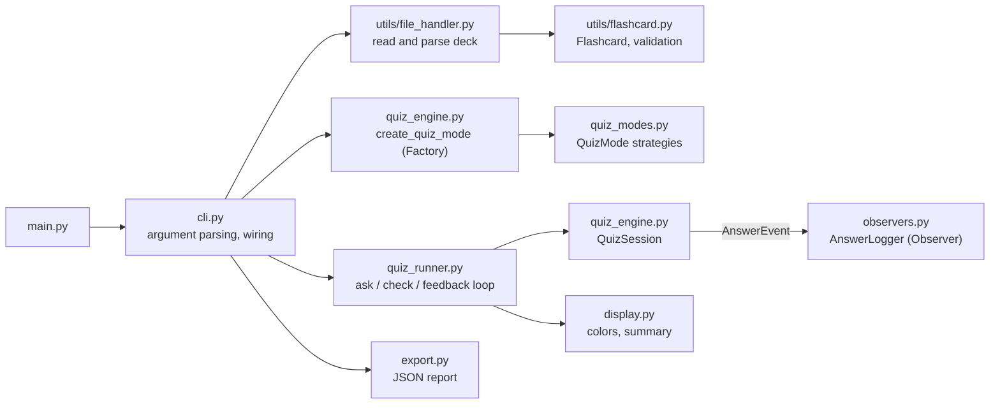

# Flashcard Quizzer

A command-line app that quizzes you on flashcards loaded from a JSON deck. It
has three quiz modes, a session summary, colored feedback, a JSON export, and a
per-answer log file. The code was built with an AI coding assistant, and the
process is documented in [`docs/ai_edit_log.md`](docs/ai_edit_log.md) and
[`docs/final_report.md`](docs/final_report.md).

## Features

- **Two deck formats:** a plain array of cards, or an object with a `cards` list.
- **Friendly errors:** malformed JSON, missing fields, unreadable files, and
  empty decks produce a one-line message and exit code 1. No tracebacks.
- **Three quiz modes**, chosen with `-m`:
  - `sequential`: cards in deck order (the default).
  - `random`: every card once, shuffled.
  - `adaptive`: every card once, then each wrong answer is asked again until it
    is answered correctly.
- **Session summary** with `--stats`: attempts, correct and incorrect counts,
  accuracy, and the most missed cards.
- **JSON export** with `--export PATH`: the same summary as a machine-readable
  report. The export location is checked before the quiz starts.
- **Answer log** with `--log-file PATH`: one timestamped line per answer.
- **Colored feedback:** green for correct, red for incorrect. Colors turn off
  when output is not a terminal, when `NO_COLOR` is set, or with `--no-color`.
- **Graceful exit:** type `exit`, press Ctrl+C, or close the input. The app
  stops cleanly and still prints the summary if `--stats` was given.

## Setup

Requires Python 3.10 or later.

```bash
python3 -m venv venv
source venv/bin/activate          # Windows: venv\Scripts\activate
python -m pip install -r requirements.txt
```

## Usage

```bash
python main.py --help
python main.py --mode sequential --file data/glossary.json
python main.py -m adaptive -f data/python_basics.json --stats
python main.py -m random -f data/glossary.json --export report.json --log-file answers.log
```

| Flag | Meaning |
|------|---------|
| `-f, --file PATH` | JSON deck to load (default: `data/glossary.json`) |
| `-m, --mode {sequential,random,adaptive}` | Order in which cards are asked |
| `--stats` | Print the session summary when the quiz ends |
| `--export PATH` | Save the session summary as JSON |
| `--log-file PATH` | Append one line per answer to a log file |
| `--no-color` | Disable colored output |

Example deck formats:

```json
[{"front": "API", "back": "Application Programming Interface"}]
```

```json
{"cards": [{"front": "def", "back": "Defines a function"}]}
```

## Architecture



### Design patterns

- **Strategy** (`quiz_modes.py`): `QuizMode` defines how cards are ordered and
  how answers affect the queue. `SequentialMode`, `RandomMode`, and
  `AdaptiveMode` are interchangeable strategies, so the session never checks
  which mode it is running.
- **Factory** (`quiz_engine.py`): `create_quiz_mode` maps the `--mode` name to
  the right strategy. Adding a mode means adding one entry to `MODE_BUILDERS`.
- **Observer** (`quiz_engine.py`, `observers.py`): `QuizSession` notifies
  registered observers with an `AnswerEvent` after every answer. The log file
  is one observer. Logging can be added or removed without touching quiz logic.

## Project layout

```
main.py              entry point
cli.py               argument parsing and wiring
quiz_engine.py       QuizSession, SessionStats, answer checking, factory
quiz_modes.py        quiz mode strategies
quiz_runner.py       interactive loop
observers.py         answer observers (log file)
export.py            JSON session report
display.py           colors and summary text
utils/               deck loading and the Flashcard model
data/                sample decks
tests/               pytest suite
docs/                AI edit log, final report, coverage summary
```

## Testing and quality

```bash
python -m pytest                                  # run the test suite
python -m pytest --cov=. --cov-report=html        # coverage report (htmlcov/)
python -m black --check .                         # formatting
python -m isort --check-only .                    # import order
python -m flake8 .                                # linting, no errors
python -m mypy .                                  # type checking, strict
```

The suite has 133 tests and measures 100% branch coverage of the application
code. The tests cover valid and invalid decks, every quiz mode, the factory's
unknown-name error, Ctrl+C and end-of-input, `exit` in any case, export and log
failures, and full sessions from the command line.

`tests/test_code_limits.py` enforces two house rules on the application code:
no function body longer than 7 lines, and no file longer than 200 lines.

### Manual checks

Some behaviour is only visible in a real terminal: colors, the `exit` command,
and Ctrl+C. `scripts/manual_tty_checks.py` runs those scenarios and the main CLI
scenarios, compares each result with what is expected, and prints PASS or FAIL.

```bash
python scripts/manual_tty_checks.py                  # print the results
python scripts/manual_tty_checks.py --json out.json  # also save them as JSON
```

The script runs the terminal scenarios inside a pseudo-terminal. It needs macOS
or Linux, and reports those scenarios as SKIPPED on Windows. Exit code 0 means
every scenario passed or was skipped.

## Dependencies

Listed in `requirements.txt`. Runtime code uses only the standard library. The
quality tools (pytest, pytest-cov, black, isort, flake8, mypy) are needed only
for development.
