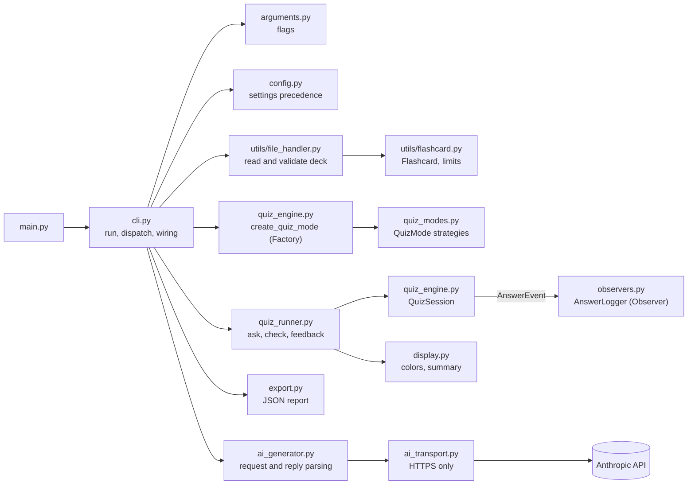
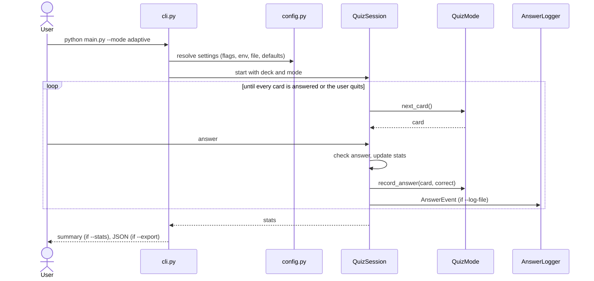
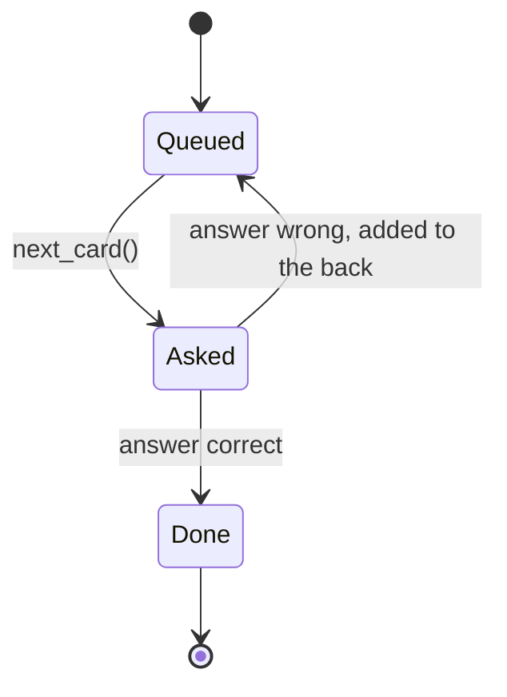
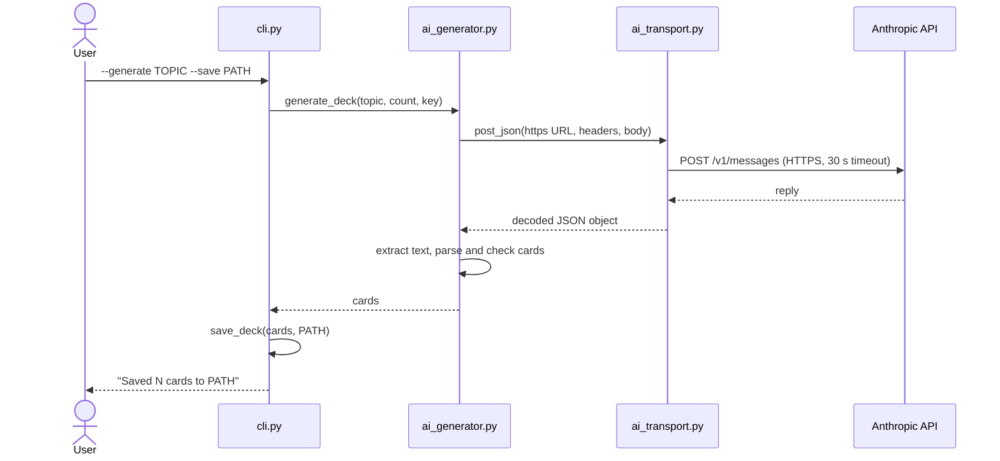

# Flashcard Quizzer

A command-line app that quizzes you on flashcards from a JSON deck. It has three
quiz modes, a session summary, colored feedback, a JSON export, a per-answer log,
an optional configuration file, and AI-assisted deck generation. The code was
built with an AI coding assistant. The process is documented in
[`docs/ai_edit_log.md`](docs/ai_edit_log.md),
[`docs/ai_interaction_analysis.md`](docs/ai_interaction_analysis.md), and
[`docs/final_report.md`](docs/final_report.md).

## Features

- **Two deck formats:** a plain array of cards, or an object with a `cards` list.
- **Friendly errors:** malformed JSON, missing fields, unreadable files, empty
  decks, and oversized input produce a one-line message and exit code 1.
- **Input limits:** deck files up to 1 MB, and each card's front and back up to
  500 characters after trimming. These stop a large or malformed file from using
  unbounded memory.
- **Three quiz modes**, chosen with `-m`:
  - `sequential`: cards in deck order (the default).
  - `random`: every card once, shuffled.
  - `adaptive`: every card once, then each wrong answer is asked again until it
    is answered correctly.
- **Configuration:** defaults can be set in a JSON file or environment variables.
  Command-line flags override both. See [Configuration](#configuration).
- **AI-assisted decks:** `--generate TOPIC` asks an AI service for flashcards and
  saves them as a deck. See [Generating a deck with AI](#generating-a-deck-with-ai).
- **Session summary** with `--stats`: attempts, correct and incorrect counts,
  accuracy, and the most missed cards.
- **JSON export** with `--export PATH`. The export location is checked before the
  quiz starts.
- **Answer log** with `--log-file PATH`: one timestamped line per answer.
- **Colored feedback:** green for correct, red for incorrect. Colors turn off
  when output is not a terminal, when `NO_COLOR` is set, or with `--no-color`.
- **Graceful exit:** type `exit`, press Ctrl+C, or close the input. The app stops
  cleanly and still prints the summary if `--stats` was given.

## Setup

Requires Python 3.10 or later.

```bash
python3 -m venv venv
source venv/bin/activate          # Windows: venv\Scripts\activate
python -m pip install -r requirements.txt
```

## Usage

```bash
python main.py --help
python main.py --mode sequential --file data/glossary.json
python main.py -m adaptive -f data/python_basics.json --stats
python main.py -m random -f data/glossary.json --export report.json --log-file answers.log
ANTHROPIC_API_KEY=... python main.py --generate "TCP/IP" --count 10 --save tcp.json
```

| Flag | Meaning |
|------|---------|
| `-f, --file PATH` | JSON deck to quiz on |
| `-m, --mode {sequential,random,adaptive}` | Order in which cards are asked |
| `--stats` | Print the session summary when the quiz ends |
| `--export PATH` | Save the session summary as JSON |
| `--log-file PATH` | Append one line per answer to a log file |
| `--no-color` | Disable colored output |
| `--generate TOPIC` | Create a deck about TOPIC with AI (needs `--save`) |
| `--count N` | Cards to generate, from 1 to 50 (default 10) |
| `--save PATH` | File to write a generated deck to |

Example deck formats:

```json
[{"front": "API", "back": "Application Programming Interface"}]
```

```json
{"cards": [{"front": "def", "back": "Defines a function"}]}
```

## Configuration

Settings come from four sources. The first one that sets a value wins:

1. Command-line flags
2. Environment variables
3. The config file
4. Built-in defaults: `mode` is `sequential`, `deck` is `data/glossary.json`, and
   `log_file` is off

| Setting | Flag | Environment variable | Config file key |
|---------|------|----------------------|-----------------|
| Quiz mode | `-m` | `FLASHCARD_MODE` | `mode` |
| Deck file | `-f` | `FLASHCARD_DECK` | `deck` |
| Log file | `--log-file` | `FLASHCARD_LOG_FILE` | `log_file` |

The config file is `flashcard.config.json` in the current folder. Set
`FLASHCARD_CONFIG` to use another path. Example:

```json
{"mode": "adaptive", "deck": "data/python_basics.json", "log_file": "answers.log"}
```

Unknown keys, a non-object file, and an unknown mode are reported as errors. A
missing config file is fine, and the defaults apply.

## Generating a deck with AI

`--generate` sends a request to the Anthropic Messages API. It needs the
`ANTHROPIC_API_KEY` environment variable. Without it, the command stops with a
message and makes no network call.

- **What is sent:** the topic, the number of cards, and the instructions. No
  deck data, answers, or personal information is sent.
- **What comes back:** the reply is checked the same way as a hand-written deck.
  A reply that is not valid JSON, is empty, or has a card without a back is
  rejected, and no file is written.
- **Where it goes:** only `https://api.anthropic.com`. Any other URL is refused
  before the request is made.
- **Limits:** the topic is 1 to 100 characters, the count is 1 to 50, and the
  request times out after 30 seconds.
- **Keys:** the key is sent only in the `x-api-key` header. It never appears in
  the output or in error messages.

The model is set by the `MODEL` constant in `ai_generator.py`. Tests replace the
network call with a fake, so they never reach the real service.

## Architecture



### Session flow



### Adaptive queue



### Generation flow



### Design patterns

- **Strategy** (`quiz_modes.py`): `QuizMode` defines how cards are ordered and
  how answers affect the queue. `SequentialMode`, `RandomMode`, and
  `AdaptiveMode` are interchangeable strategies, so the session never checks
  which mode it is running.
- **Factory** (`quiz_engine.py`): `create_quiz_mode` maps the mode name to its
  strategy. Adding a mode means adding one entry to `MODE_BUILDERS`.
- **Observer** (`quiz_engine.py`, `observers.py`): `QuizSession` notifies
  registered observers with an `AnswerEvent` after every answer. The log file is
  one observer, so logging can be added or removed without touching quiz logic.

## Security

- **Untrusted input:** deck files and AI replies are treated as untrusted. They
  are size-limited, parsed as JSON only, and validated field by field before use.
- **Network:** only HTTPS URLs are opened, and the transport checks the scheme
  before calling `urlopen`. Bandit reports no issues in the app code.
- **Secrets:** the API key is read from the environment and sent only in a
  header. Error messages never contain it.
- **Dependencies:** `pip-audit` reports no known vulnerabilities for
  `requirements.txt`. The generator uses only the standard library, so it adds no
  runtime dependency.
- **Output files:** `--export` and `--save` check their target folder before
  writing, and the quiz does not start if an export path cannot be used.

## Performance

Measured on Apple M5 Pro with Python 3.11. Loading a 100,000-card deck takes about
57 ms, and a 10,000-answer session takes about 66 ms. The decisions behind the
current design are recorded in [`docs/performance_decisions.md`](docs/performance_decisions.md).

## Project layout

```
main.py              entry point
cli.py               run, dispatch, and wiring
arguments.py         command-line flags
config.py            settings from flags, environment, file, and defaults
quiz_engine.py       QuizSession, SessionStats, answer checking, factory
quiz_modes.py        quiz mode strategies
quiz_runner.py       interactive loop
observers.py         answer observers (log file)
export.py            JSON session report
display.py           colors and summary text
ai_generator.py      building the AI request and checking its reply
ai_transport.py      HTTPS transport for the AI service
utils/               deck loading, saving, and the Flashcard model
data/                sample decks
tests/               pytest suite
scripts/             manual terminal checks
docs/                logs, analysis, reports, and performance notes
```

## Testing and quality

```bash
python -m pytest                                  # run the test suite
python -m pytest --cov=. --cov-report=html        # coverage report (htmlcov/)
python -m black --check .                         # formatting
python -m isort --check-only .                    # import order
python -m flake8 .                                # linting, no errors
python -m mypy .                                  # type checking, strict
python -m bandit -r . -x ./venv,./tests,./scripts # security scan of app code
python -m pip_audit -r requirements.txt           # known dependency vulnerabilities
```

The suite has 204 tests and measures 100% branch coverage of the application
code. The tests cover valid and invalid decks and oversized input, every quiz
mode, configuration precedence, the AI generator with a fake transport, Ctrl+C
and end-of-input, `exit` in any case, export and log failures, and full sessions
from the command line.

`tests/test_code_limits.py` enforces two house rules on the application code: no
function body longer than 7 lines, and no file longer than 200 lines.

### Manual checks

Some behaviour is only visible in a real terminal: colors, the `exit` command,
and Ctrl+C. `scripts/manual_tty_checks.py` runs those scenarios and the main CLI
scenarios, compares each result with what is expected, and prints PASS or FAIL.

```bash
python scripts/manual_tty_checks.py                  # print the results
python scripts/manual_tty_checks.py --json out.json  # also save them as JSON
```

The terminal scenarios run inside a pseudo-terminal. They need macOS or Linux,
and are reported as SKIPPED on Windows. Exit code 0 means every scenario passed
or was skipped.

## Dependencies

Listed in `requirements.txt`. The runtime code uses only the standard library.
The quality and security tools (pytest, pytest-cov, black, isort, flake8, mypy,
bandit, pip-audit, pre-commit) are needed only for development.
